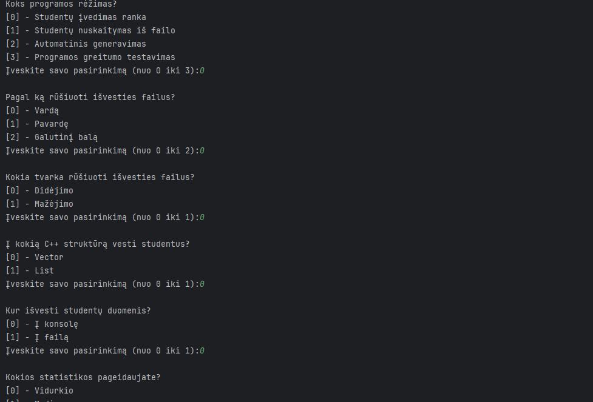
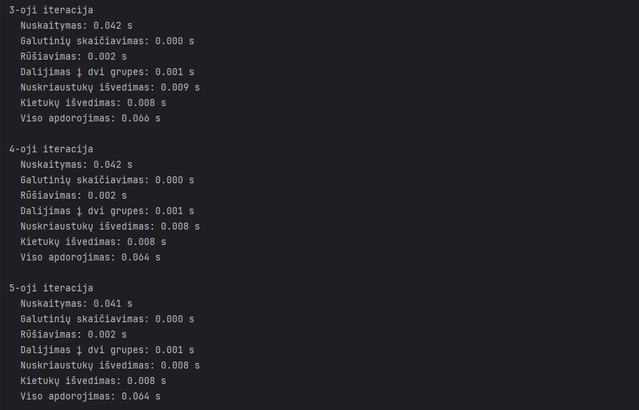
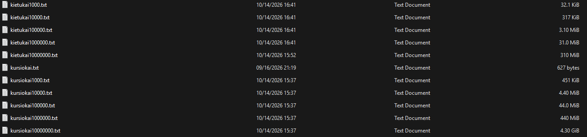

# OOP-Project
## Introduction
This program was written as a project for an Object Oriented Programming course. The purpose of the program is to read or generate student data which will then be used to calculate their final grades.

## Build
The project uses CMake (3.16 or newer) and requires a C++17 compiler.
```bash
cmake -B build -DCMAKE_BUILD_TYPE=Release
cmake --build build
```
When using a multi-config generator (e.g. Visual Studio), build with:
```bash
cmake --build build --config Release
```
The program reads and writes data files in its working directory, so run it from the folder where you want the generated files to be stored.

## Usage
Upon running the compiled program, the user will be prompted with several options to decide the behavior of the program. 



The following formula is used for final grade calculation:
```math
Final grade = 0.4 \cdot average\space or\space median + 0.6 \cdot exam
```

## Structure
Most of the logic is written as function templates over a generic `Konteineris` type, so the same code works with both `std::vector<Studentas>` and `std::list<Studentas>`. The container is chosen once, at runtime, in `main.cpp`. Where the two containers need different code (sorting), `if constexpr` picks the right version at compile time.

### main.cpp
The program's entry point. It asks the user to choose a mode (manual entry, random generation, reading from a file, or benchmark), a sort field and order, a container, an output target and which statistic to show. It then calls the matching template function with either `std::vector<Studentas>` or `std::list<Studentas>`.

### studentas.h
- `struct Studentas`: first name, last name, homework grades, exam grade and final grade.
- `skaiciuotiGalutini()`: calculates the final grade (0.4 × homework average + 0.6 × exam).
- `rusiuotiStudentus()`: sorts by first name, last name or final grade, in ascending or descending order. Uses `std::sort` for `vector` and the member `list::sort()` for `list`.
- `skirstytiStudentusMano()`: splits students into failing (*nuskriaustukai*, final grade < 5) and passing (*kietukai*, final grade ≥ 5) groups using `std::move` to move students from the original container into two new ones, leaving the original one empty..
- `skirstytiStudentus1()`: splits students into two groups in a similar way to `skirstytiStudentusMano()`, using `push_back` instead of `std::move`.
- `skirstytiStudentus2()`: splits students into two groups by finding failing ones, moving them into a new container and erasing them from the original one. The end result is 2 containers with passing and failing students.
- `skirstytiStudentus1Partition()`: works as an improved version of `skirstytiStudentusMano()` that groups students into two new containers, first partitioning students by passing grade using `std::partition`.
- `skirstytiStudentus2Partition()`: works as an improved version of `skirstytiStudentus2()` that partitions students by passing grade using `std::partition`, then moves the failing ones into a new container with a single `insert` and erases them from the original one with a single `erase`.

### manual.h / manual.cpp
Console interaction and the non-benchmark modes:
- `nustatymai()`, `ivestiSk()`, `taipArNe()`: menu prompts and validated number and yes/no input.
- `ivestiRanka()`: manual entry, with an option to generate grades randomly. After each student is added, it prints the student's address in memory.
- `nuskaitytiIsFailo()`: reads, processes and outputs students from an existing file.
- `rasytiAntraste()`, `rasytiStudenta()`, `rasytiGrupe()`: write the formatted results table to the console or a file.

### failai.h / failai.cpp
File I/O:
- `generuotiFaila()`: generates a test file with *n* random students. The whole file is built in a `stringstream` first and written to disk in one go.
- `nuskaitytiStudentus()`: reads a student file into any container.
- `isvestiStudentus()`: writes a group of students to a file.
- `arFailaiEgzistuoja()`: checks whether the benchmark files already exist, so they don't have to be regenerated.

### testai.h / testai.cpp
The benchmark. `testas()` times each step (read, final grade calculation, sort, grouping, writing both groups) on one file. `testuPaleistuvas()` repeats the test 5 times per file for the chosen container and averages the results. `paleistiAtmintiesTestus()` runs the memory test by launching the program again as a separate process for every grouping method, so that the peak memory resets between tests. `vienasTestas()` is the test run inside that process: it reads the students, groups them with the chosen method and outputs how much peak memory grew during grouping.

### results.h / results.cpp
`struct Rezultatai` stores the average time for each step. `spausdintiLentele()` exports all results as a Markdown table, which is where the tables in this README come from.

### nustatymai.h
The `enum class` types that hold the program's settings: `Rezimas`, `Struktura`, `Rusiuoti`, `Tvarka`, `Statistika` and `Isvedimas`.

### timer.h
A small `Timer` class built on `std::chrono::high_resolution_clock`, with `reset()` and `elapsed()`.

### utils.h / utils.cpp
Helpers:
- `vidurkis()`, `mediana()`: calculate the average and the median of the homework grades.
- `utf8Plotis()`: corrects `setw` column width for Lithuanian UTF-8 characters.
- `pikineAtmintis()`: returns the peak memory used by the program so far, in bytes. Used by the memory test to measure how much the peak grew during grouping. On Windows it uses `GetProcessMemoryInfo`, and on Linux it reads `VmHWM` from `/proc/self/status`.
- `dabartineAtmintis()`: returns how much memory the program is using right now, in bytes. Works the same way as `pikineAtmintis()`, but reads `VmRSS` on Linux.

### kursiokai.txt
A small sample student file for testing the read-from-file mode.


## Benchmarking
Upon running the app, users have the option to select a benchmarking mode. During the benchmarking mode the program randomly generates 5 files with varying amounts of students which will then be used to test the program's performance on analyzing them. Students are put in a failing group *(nuskriaustukai)* if their grade is lower than 5 and a passing group *(kietukai)* if their grade is 5 or greater.
All steps are timed and repeated 5 times, the average time for each step is calculated and output to the console.

The goal of the benchmark is to compare performance between the Vector and List containers in this app and to decide which one fits the program better.



## Benchmark Results

### Vector
|Student count|Average file read time|Average final grade calculation time|Average sorting time|Average grouping time (Original Method)|Average grouping time (Method 1)|Average grouping time (Method 2)|Average grouping time (Method 1 with partition)|Average grouping time (Method 2 with partition)|Average failed student output time|Average passing student output time|Average processing time|
|---|---|---|---|---|---|---|---|---|---|---|---|
|1000|0.003s|0.000s|0.000s|0.000s|0.000s|0.000s|0.000s|0.000s|0.000s|0.000s|0.004s|
|10000|0.009s|0.000s|0.001s|0.000s|0.000s|0.000s|0.000s|0.000s|0.001s|0.001s|0.016s|
|100000|0.064s|0.001s|0.010s|0.002s|0.003s|0.001s|0.002s|0.001s|0.009s|0.008s|0.122s|
|1000000|0.629s|0.007s|0.104s|0.018s|0.029s|0.012s|0.015s|0.010s|0.134s|0.138s|1.453s|
|10000000|6.367s|0.061s|1.157s|0.217s|0.341s|0.137s|0.149s|0.102s|1.457s|1.464s|14.631s|


### List
|Student count|Average file read time|Average final grade calculation time|Average sorting time|Average grouping time (Original Method)|Average grouping time (Method 1)|Average grouping time (Method 2)|Average grouping time (Method 1 with partition)|Average grouping time (Method 2 with partition)|Average failed student output time|Average passing student output time|Average processing time|
|---|---|---|---|---|---|---|---|---|---|---|---|
|1000|0.001s|0.000s|0.000s|0.000s|0.000s|0.000s|0.000s|0.000s|0.000s|0.000s|0.004s|
|10000|0.010s|0.001s|0.001s|0.000s|0.003s|0.000s|0.001s|0.001s|0.002s|0.002s|0.047s|
|100000|0.073s|0.010s|0.023s|0.004s|0.033s|0.007s|0.025s|0.019s|0.014s|0.017s|0.495s|
|1000000|0.734s|0.098s|0.588s|0.038s|0.356s|0.075s|0.300s|0.206s|0.240s|0.236s|5.709s|
|10000000|8.471s|1.074s|14.194s|0.388s|3.666s|0.812s|3.440s|2.569s|3.074s|3.024s|71.211s|

### Memory usage when grouping 10,000,000 students (Vector)
|Method|Peak memory used (MiB)|
|---|---|
|Original|1214 MiB|
|Method 1|2235 MiB|
|Method 2|1215 MiB|
|Method 1 with partition|542 MiB|
|Method 2 with partition|542 MiB|


### Testing Conditions
Test system:
- CPU: AMD Ryzen AI 9 HX 370 (12 cores / 24 threads)
- RAM: 32 GB LPDDR5X
- Storage: NVMe SSD
- OS: Linux (CachyOS, kernel 7.3.0)
- Compiler: GCC 16.2.1
- Power: AC (plugged in), Balanced profile
- Results: Average of 5 runs on pre-generated files
- Files were generated once per build
- Optimizations used: -O3 -DNDEBUG
- Sorted by final grade descending, after grouping

### Grouping method comparison
#### Speed
With vector, Method 2 with partition was the fastest: 0.10 s for 10M students. It creates only one new container and only moves the failing students (about half of all students), while the passing ones stay in the original container. After `std::partition` the failing students are all at the end of grupe, so they are moved out with a single `insert`, which knows the number of elements in advance and allocates the new container only once, and removed with a single `erase`.

Method 2 (0.14 s with vector) moves the same students, but does it one at a time. Each failing student costs a move into nuskriaustukai, a move of the last element into the gap and deletion of the shell made from `pop_back()`, and nuskriaustukai has to reallocate as it grows. Nothing has to be done with the passing students, which still makes it faster than the methods that create two new containers.

Method 1 with partition (0.15 s with vector) moves every student into a new container, but bulk insert allocates each container only once. Since students are sorted after grouping, `std::partition` is used instead of `std::stable_partition` in both partition methods, as the order of students doesn't need to be kept.

The Original method (0.22 s with vector) touches each student once and only moves pointers, without copying any string or grade data. However, it moves every student with `push_back`, so with vector both new containers have to reallocate repeatedly as they grow, moving the students again each time. This makes it about 2× slower than Method 2 with partition.

With list the order is different. The Original method was the fastest (0.39 s), followed by Method 2 (0.81 s), while both partition methods were much slower (2.57 s and 3.44 s). With list there is no reallocation, so the main advantage of bulk insert is gone and `insert` still has to allocate a new node for every student. On top of that, `std::partition` has to swap students between nodes scattered all across memory, which makes it an extra full pass that the Original method doesn't need.

Method 1 is the slowest with both containers: about 1.6× slower than the Original with vector (0.34 s) and 9.4× slower with list (3.67 s). Copying a student allocates new memory for its name, surname and grades, and with millions of students the time spent accumulates.

#### Memory

Method 1 needed the most memory, about 1 GB more than the other methods (+2235 MiB). After copying, every student exists twice: once in grupe and once in a new container. That confirms Method 1 is the most memory-inefficient.

The Original method and Method 2 both used about +1214 MiB. Since moving transfers the existing strings and grade containers, the only new memory is for the Studentas objects themselves. However, both grow their new containers with `push_back`, so the vector capacity can end up larger than needed, and during reallocation the old and the new buffer exist at the same time.

Both partition methods used the least memory (+542 MiB), less than half of the Original method. Bulk insert knows the number of elements in advance and allocates each container once, at just the needed size, so there is no reallocation.
##### Conclusion

With vector, Method 2 with partition is the best choice: it was the fastest and, together with Method 1 with partition, used the least memory, because it only moves about half of the students and allocates the new container once. With list, the Original method was the fastest, as the algorithms that help vector only add extra work for list. Method 1 is the worst choice on both counts, because copying duplicates all the data.

#### Vector vs list

The results show that `vector` is the better fit for this program. At 10,000,000 students the total processing time was 14.6s with Vector versus 71.2s with List, about 387% slower. The gap starts to show at 10,000 students and widens as the data grows.

Reading the file and writing the results show the smallest relative difference between the containers (about 1.3x and 2.1x), because these steps are dominated by text parsing and disk I/O rather than by the container. The largest differences come from three steps:

- Sorting showed the largest gap: at 10,000,000 students it took 1.2s with Vector and 14.2s with List, roughly 12x slower. Vector uses std::sort (introsort), which needs random-access iterators and works on elements stored next to each other in memory. List cannot use std::sort and relies on its own list::sort (merge sort) which is significantly slower. With List, sorting alone takes about 20% of the total processing time.
- Final grade calculation was about 18x slower with List (0.06s vs 1.07s). The difference comes from memory layout: Vector stores its elements next to each other, while List elements are scattered all across memory, which makes it more difficult for the CPU to access.
- Grouping was slower with List for every method. With the Original method the gap is small (0.22s vs 0.39s, about 1.8x), but the methods using algorithms lose most of their advantage: Method 2 with partition was about 25x slower with List (0.10s vs 2.57s). The List versions could be improved by moving nodes between lists with splice, which needs no allocation or copying.
In short, List's strengths (easy insertion and removal in the middle) are not used by this program, while its weaknesses affect every step that touches the container. Vector is therefore the better choice.


## Disclaimer
The generation of the text files is likely to take a large amount of time (about 30 seconds) as well as a large amount of storage (about 5GB). Further processing of the files (5 runs for every file) takes about 8 minutes on the release build.



## Releases

### [v1.0](https://github.com/Darius-Varnelis/OOP-Project/releases/tag/v1.0)
- Added four more strategies for splitting students into passing and failing groups, next to the original `std::move` method:
  - **Method 1** (`skirstytiStudentus1`) copies students into two new containers.
  - **Method 2** (`skirstytiStudentus2`) moves failing students into a new container and removes them from the original one by moving the last element into the gap and calling `pop_back()`.
  - **Method 1 with partition** (`skirstytiStudentus1Partition`) groups students with `std::partition`, then bulk-moves each group into a new container with `insert` and `std::make_move_iterator`.
  - **Method 2 with partition** (`skirstytiStudentus2Partition`) groups students with `std::partition`, then bulk-moves the failing ones into a new container and removes them from the original one with a single `erase`.
- Added timing for all grouping methods to the benchmark, for both `vector` and `list`.
- Added peak memory measurement during grouping. Each test runs in a separate process so the peak counter resets between methods.
- The vector/list choice now applies to every container in the program.
- Added an option to delete the generated benchmark files.
- README: added a grouping method comparison (speed and memory) and updated the benchmark results.

### [v0.3](https://github.com/Darius-Varnelis/OOP-Project/releases/tag/v0.3)
- Added `std::list` as an alternative to `std::vector`, chosen at runtime. All logic was rewritten as templates over the container.
- Added a vector vs list benchmark that runs both containers right away.
- Added a sorting order option (ascending/descending).
- Manual entry now supports sorting, random grade generation and writing the results to a file.
- Added an option to read student data from an existing file.
- Moved the test logic and settings enums into separate files.
- Fixed an out-of-memory bug and added error handling for invalid input.
- README: added a program structure overview, images and a vector vs list analysis.

### [v0.2](https://github.com/Darius-Varnelis/OOP-Project/releases/tag/v0.2)
- Added random test file generation. The whole file is built in a `stringstream` before being written to disk.
- Added splitting students into failing (*nuskriaustukai*) and passing (*kietukai*) groups, each written to its own file.
- Added a `Timer` class and timing of each step, repeated 5 times per file and averaged.
- Added sorting by a user-chosen field.
- Benchmark results are exported as a Markdown table.
- Split `main.cpp` into separate source and header files, and switched to consistent naming (camelCase functions, PascalCase structs).
- Added CMake build support.

### [v0.1](https://github.com/Darius-Varnelis/OOP-Project/releases/tag/v0.1)
- Added reading student data from a file (`kursiokai.txt`).
- Sorted output and a separator line between the header and the data.
- Added support for Lithuanian characters on Windows.
- Readability improvements using `constexpr` and `enum class`.

### [v.pradinė](https://github.com/Darius-Varnelis/OOP-Project/releases/tag/v.pradin%C4%971)
- First version: manual student entry with homework and exam grades.
- Final grade calculation using the average or the median of homework grades.
- Input validation, including entry of an unknown number of grades.
- An option to generate grades randomly, with a seeded random generator.
